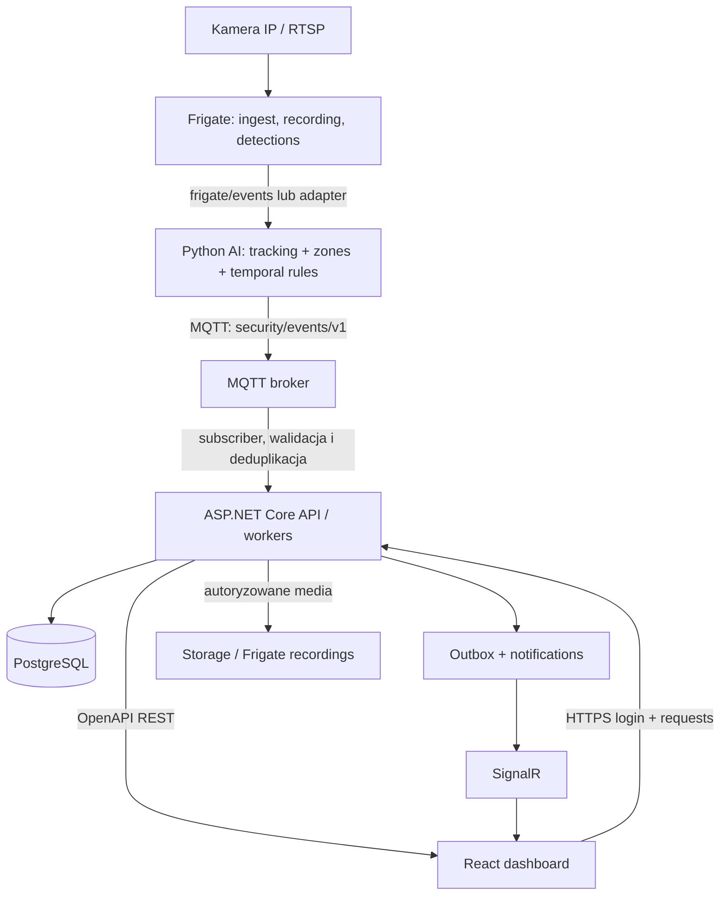

# AI Security Camera — MVP: plan realizacji dla zespołu developerskiego

> **Status:** dokument startowy do zatwierdzenia przez zespół  
> **Wersja:** 1.0  
> **Zespół:** 4 developerów  
> **Horyzont planistyczny:** 8 sprintów po 2 tygodnie (16 tygodni), przy założeniu około 15–20 godzin pracy tygodniowo na osobę  
> **Docelowe wdrożenie:** pojedyncza instalacja lokalna (dom / podjazd), bez zależności od chmury do detekcji  
> **Jedno źródło prawdy:** prywatne repozytorium GitHub + GitHub Projects + GitHub Issues

## 0. Jak korzystać z dokumentu

Ten dokument ma być **instrukcją realizacji projektu**. Nie jest reklamowym opisem produktu ani gwarancją skuteczności AI.

1. Na spotkaniu technicznym zatwierdzić lub zmienić decyzje w sekcji 3; każde odstępstwo od proponowanej architektury opisać w ADR (*Architecture Decision Record*).
2. Założyć prywatne repozytorium `ai-security`, projekt Kanban i Issues opisane w sekcji 16.
3. Utworzyć kontrakty z sekcji 8–10 **przed** niezależną implementacją usług.
4. Wykonać najpierw *vertical slice*: **mock AI → MQTT → backend → PostgreSQL → REST → React**.
5. Dopiero po działającym przepływie podmienić mock AI na integrację z kamerą i analizę rzeczywistych zdarzeń.
6. Zamknąć każdy sprint demonstracją działającego przyrostu i dowodami testów.

Wartości liczbowe w metrykach są **celami pilota**, a nie deklaracją rzeczywistych możliwości modelu. Jeśli testy nie potwierdzą wykonalności, zakres MVP należy skorygować.

---

## 1. Cel produktu i definicja MVP

### 1.1 Problem

Zwykłe kamery nagrywają obraz lub alarmują po wykryciu ruchu, generując dużo nieistotnych powiadomień. Produkt ma analizować **kontekst zdarzenia w czasie i określonej strefie**, aby informować o zachowaniu wymagającym uwagi właściciela posesji.

System **nie ustala winy ani zamiarów osoby**. Komunikat ma opisywać obserwacje, np. „osoba długo przebywa w zastrzeżonej strefie przy samochodzie”, a nie „wykryto złodzieja”.

### 1.2 Użytkownik MVP

Jedna prywatna instalacja: właściciel domu lub samochodu, jedna posesja, jeden administrator, docelowo 1–2 kamery IP. Jeden wariant podstawowego wdrożenia na Linux + Docker Compose.

### 1.3 Scenariusze P0 (obowiązkowe)

| ID | Scenariusz | Oczekiwane działanie |
|---|---|---|
| UC-01 | Osoba pojawia się w prywatnej strefie monitorowanej | System rejestruje wejście wraz z czasem, kamerą i dowodem wideo; reguła decyduje, czy wysłać alert. |
| UC-02 | Osoba pozostaje w wyznaczonej strefie przy samochodzie dłużej niż próg | System tworzy zdarzenie `vehicle_proximity_loitering`, z informacją o czasie i strefie. |
| UC-03 | Użytkownik weryfikuje alert | Użytkownik może zobaczyć powód alertu, odtworzyć powiązany klip i oznaczyć zdarzenie jako prawidłowe, fałszywe lub niepewne. |
| UC-04 | Kamera chwilowo traci połączenie | System wykrywa problem, pokazuje status oraz wznawia przetwarzanie po odzyskaniu strumienia. |
| UC-05 | Brak połączenia internetowego | Lokalna detekcja, zapis zdarzeń i panel działają nadal w sieci lokalnej. |

**Ważne ograniczenie:** stwierdzenie, że ktoś faktycznie pociąga za klamkę, wybija szybę albo kradnie auto, zwykle wymaga lepszego materiału, właściwego kąta kamery, anotacji i walidacji niż sama detekcja sylwetki. W MVP można pokazać *podejrzenie interakcji przy pojeździe* jako eksperymentalną regułę, ale **nie uczynić rozpoznawania kradzieży warunkiem odbioru MVP**.

### 1.4 Co wchodzi w MVP

- Obsługa jednej rzeczywistej kamery RTSP; architektura przygotowana na dwie.
- Lokalny serwis wideo (Frigate) i usługa analizy Python.
- Detekcja osoby i pojazdu, śledzenie obiektu, strefy i proste reguły czasowe.
- Przesyłanie zdarzeń do backendu kontraktem JSON przez MQTT.
- Backend ASP.NET Core, PostgreSQL, autoryzacja, reguły alertów i REST API.
- Dashboard webowy React + TypeScript: logowanie, status, historia, szczegóły, podgląd dowodów i ocena zdarzenia.
- Powiadomienia **wewnątrz aplikacji** przez SignalR; historia dostępna po ponownym zalogowaniu.
- Przechowywanie materiału wideo jako plików i metadanych w bazie, z kontrolą dostępu i retencją.
- Docker Compose, pipeline CI, testy, podstawowy monitoring, backup i procedura rollbacku.

### 1.5 Poza MVP

- Rozpoznawanie twarzy i identyfikacja konkretnych osób.
- Automatyczne wzywanie policji, aktywne odstraszanie, zdalne sterowanie zamkami/bramą.
- Wykrywanie broni, rozbijania szyby, odkręcania kół lub *gwarantowane* wykrywanie próby kradzieży.
- Zaawansowane VLM/LLM analizujące każdą klatkę; trenowanie od zera własnego dużego modelu.
- Śledzenie jednej osoby między wieloma kamerami.
- Aplikacja natywna iOS/Android; mobilne push-notyfikacje.
- System SaaS, multi-tenant, subskrypcje, płatności i rozbudowany panel instalatora.
- Rozbudowana analityka biometryczna, monitoring miejsc publicznych.

### 1.6 Kryteria sukcesu MVP

1. Sztuczne zdarzenie przechodzi **mock AI → MQTT → .NET → baza → REST → React** w czystym środowisku testowym.
2. Rzeczywista kamera RTSP generuje detekcje, a reguła strefy lub czasu tworzy zdarzenie i link do klipu.
3. Interfejs pozwala zobaczyć, przefiltrować i ocenić zdarzenie; tylko uprawniony użytkownik pobiera klip.
4. System wytrzymuje restart usług, ponowne dostarczenie wiadomości MQTT i krótkie przerwanie połączenia z kamerą bez błędnego zwielokrotnienia zdarzeń.
5. Lokalny pipeline nadal działa bez dostępu do internetu (zakładając działającą LAN, zasilanie i lokalną infrastrukturę).
6. Pipeline CI, skanowanie zależności, testy kontraktowe i dokumentacja wdrożenia działają odtwarzalnie.
7. Istnieje raport ewaluacji AI na oznaczonym, odseparowanym zbiorze testowym z liczbą false-positive na kamerodzień.
8. Żaden krytyczny problem bezpieczeństwa/prywatności nie pozostaje nierozwiązany przy wydaniu pilota.

---

## 2. Organizacja zespołu

| Rola | Odpowiada za | Weryfikuje/backup |
|---|---|---|
| **D1: Tech Lead / Backend** | wymagania techniczne, modele domenowe, API, migracje DB, autoryzację, koordynację zależności | D3 dla API, D4 dla bezpieczeństwa |
| **D2: AI / Computer Vision** | integrację detekcji z Frigate, tracking, strefy, reguły czasowe, dane testowe, ewaluację modeli | D1 dla kontraktów, D4 dla wydajności |
| **D3: Frontend / UX** | React, widoki, typy generowane z OpenAPI, mocki API, testy UI/E2E, dostępność | D1 |
| **D4: DevOps / QA / Security** | GitHub, CI/CD, Compose, brokera, staging, monitoring, backup, skany, bezpieczeństwo i runbook | D1 |

**Reguły:**

- Jedno Issue ma **jednego** właściciela. Współpraca odbywa się przez subtaski, review lub przypisanych współpracowników.
- Co najmniej jedna osoba inna niż autor zatwierdza PR; zmiany dotyczące bezpieczeństwa lub danych osobowych sprawdza także D4.
- Decyzje wpływające na wiele komponentów zapisujemy w `docs/architecture/adr/`.
- Każdy komponent ma backup/reviewera. Minimum raz na sprint właściciel pokazuje innym, jak go uruchomić i zdiagnozować.
- Architektoniczne spory rozstrzyga D1 po zebraniu stanowisk zainteresowanych. Niespełnione bramki bezpieczeństwa nie podlegają „przegłosowaniu”.

### Rytm spotkań

- Planowanie sprintu: co 2 tygodnie, 60 min.
- Codzienny asynchroniczny update w dni robocze: `Wczoraj / Dziś / Blokery`.
- Sync kontraktów i integracji: 2 × 20 min tygodniowo.
- Refinement backlogu: 30 min tygodniowo.
- Demo i retro: koniec każdego sprintu, po 30 min.
- Bloker zgłaszamy w dniu wykrycia. Nie ukrywamy go jako `In Progress`.

---

## 3. Decyzje techniczne na drugie spotkanie

Poniższe propozycje należy **zatwierdzić** jako ADR-001–ADR-010, zamiast zakładać, że są już ostateczne.

| ADR | Proponowana decyzja | Dlaczego |
|---|---|---|
| 001 | Lokalny Linux, Docker Compose | prosty, powtarzalny pilot |
| 002 | Frigate + RTSP jako podstawowy tor wideo | nie budujemy własnego NVR od zera |
| 003 | Python jako oddzielny serwis analizy | niezależne eksperymenty AI |
| 004 | MQTT z JSON Schema dla AI → backend | asynchroniczne, wersjonowane zdarzenia |
| 005 | ASP.NET Core 10 jako modularny monolit | jedno API i jedna warstwa logiki biznesowej |
| 006 | PostgreSQL + EF Core migrations | jedno źródło danych aplikacji |
| 007 | React + TypeScript + Vite | szybki klient webowy z generowanymi typami |
| 008 | REST/OpenAPI + SignalR | kontrakt statyczny i powiadomienia real-time |
| 009 | ASP.NET Core Identity, cookie auth, HTTPS | bezpieczne logowanie pojedynczego właściciela |
| 010 | Jedno prywatne repo + GitHub Projects | spójna widoczność statusu, kodu i zależności |

**Warunki wstępne:** kamera i sprzęt są kompatybilne z wybranymi narzędziami; sprawdzona jest licencja Frigate, modelu/wag, datasetów i innych bibliotek; decyzja o ewentualnej komercjalizacji nie jest przesądzona bez oceny licencji.

---

## 4. Architektura docelowa MVP



### Odpowiedzialność komponentów

| Komponent | Robi | Nie robi |
|---|---|---|
| Kamera | wysyła obraz | nie posiada kont użytkowników aplikacji |
| Frigate | odbiera/archiwizuje obraz, wykrywa obiekty, publikuje zdarzenia | nie ustala zasad dostępu i historii biznesowej |
| Python AI | łączy detekcje w obserwowane zachowania, emituje *SecurityEvent* | nie zapisuje do głównej bazy PostgreSQL |
| Backend | waliduje i zapisuje zdarzenia, autoryzuje, reguły, alerty, media | nie analizuje każdej klatki |
| PostgreSQL | dane użytkowników, kamer, stref, zdarzeń i powiadomień | nie przechowuje surowego materiału wideo |
| React | prezentacja, formularze, powiadomienia i ocena zdarzeń | nie uzyskuje bezpośredniego dostępu do PostgreSQL ani sekretów RTSP |

### Założenia integracyjne

- Przetwarzanie ciężkiego obrazu nie odbywa się synchronicznie podczas requestu HTTP.
- Python AI dostarcza **zdarzenia**, nie strumienie klatek, do .NET.
- MQTT działa co najmniej w semantyce *at least once*; backend jest odporny na duplikaty (`source_event_id UNIQUE`).
- Serwis odbierający MQTT powinien trwale zapisać zdarzenie przed potwierdzeniem jego przetworzenia; zapewnić retry/dead-letter według wybranego klienta i brokera.
- Powiadomienia po zapisie realizuje worker/outbox, aby błąd SignalR nie powodował utraty alertu.
- Klipy mają identyfikator/storage key; **nigdy** nie zapisujemy haseł kamer, tokenów, publicznych URL-i z credentialami lub binarnego wideo w zdarzeniu.
- Dla klienta frontendowego wszystkie operacje idą przez HTTPS do backendu. Zdalny dostęp w pilocie przez VPN (np. Tailscale), bez wystawiania RTSP/MQTT/PostgreSQL na internet.

---

## 5. Repozytorium i sposób pracy

### 5.1 Monorepo

```text
ai-security/
├── .github/
│   ├── workflows/{backend,frontend,ai,security,release}.yml
│   ├── ISSUE_TEMPLATE/
│   ├── PULL_REQUEST_TEMPLATE.md
│   └── CODEOWNERS
├── apps/
│   ├── backend/
│   │   ├── Security.Api/
│   │   ├── Security.Application/
│   │   ├── Security.Domain/
│   │   ├── Security.Infrastructure/
│   │   └── Security.Tests/
│   └── dashboard/
│       ├── src/{api,components,pages,features,auth}/
│       └── tests/
├── services/behavior-ai/
│   ├── src/
│   ├── tests/
│   └── configs/
├── packages/contracts/
│   ├── openapi/openapi.yaml
│   ├── events/security-event.v1.schema.json
│   └── fixtures/
├── ml/{evaluation,manifests,model-cards}/
├── infrastructure/{docker,monitoring,scripts}/
├── docs/
│   ├── product/{vision,requirements}.md
│   ├── architecture/{system,database-design}.md
│   ├── architecture/adr/
│   ├── ml/{dataset-card,evaluation}.md
│   ├── security/{threat-model,privacy}.md
│   ├── operations/{runbook,release}.md
│   └── project/{decisions,risks,meetings}.md
├── compose.yaml
├── compose.dev.yaml
├── .env.example
├── README.md
└── CONTRIBUTING.md
```

Katalogi to plan, nie wymaganie tworzenia pustych folderów. Najpierw dodajemy tylko to, co jest używane.

### 5.2 GitHub Projects

**Kolumny:** `Backlog → Ready → In Progress → In Review → Testing → Done` oraz status/etykieta `Blocked`.

**Pola:** `ID`, `Title`, `Epic`, `Priority`, `Owner`, `Reviewer`, `Status`, `Sprint`, `Estimate`, `Depends on`, `Blocks`, `Acceptance criteria`, `Evidence`, `Target release`.

**Branching:** `main` (protected), krótkie gałęzie `feat/SEC-032-event-api`, `fix/SEC-033-deduplication`; merge wyłącznie przez PR.

**PR obowiązkowo zawiera:** powiązany issue, opis zmiany, wpływ na kontrakty/schema, testy i wynik, screenshot UI gdy dotyczy, ryzyka, instrukcję migracji i rollbacku jeśli dotyczy.

**Definition of Ready:** opis i kryteria są testowalne, zależności i kontrakty uzgodnione, dostępne mocki/test-data, brak niezidentyfikowanych blokerów.

**Definition of Done:** kod + testy + review + CI + dokumentacja + demonstracja/rezultat w staging + zamknięte zależności i błędy krytyczne.

**Działania nieplanowane:** dodaj issue z priorytetem. Zakaz „dorabiania” dużej funkcji poza boardem.

---

## 6. Struktura backendu (.NET)

Jeden **modularny monolit**, nie zestaw mikroserwisów. Wstępny układ:

- `Security.Api`: endpointy REST, SignalR hub, middleware błędów, uwierzytelnianie.
- `Security.Application`: use cases, DTO, walidacja, mapowanie, reguły alertów, interfejsy repozytoriów.
- `Security.Domain`: encje, enumeracje, reguły domenowe, spójność zdarzeń.
- `Security.Infrastructure`: EF Core/PostgreSQL, konsument MQTT, media provider, outbox i notification worker, integracje z Frigate.
- `Security.Tests`: testy jednostkowe, integracyjne i kontraktowe.

### Moduły funkcjonalne

| Moduł | Funkcje | Odpowiedzialny |
|---|---|---|
| Auth | logowanie, wylogowanie, sesje, role, kontrola dostępu | D1 |
| Cameras | rejestr kamer, status i metadane konfiguracji | D1 |
| Zones | strefy, wielokąty, progi, dostępne konfiguracje | D1 + D2 |
| EventIngestion | MQTT subscriber, walidacja JSON Schema, mapowanie, idempotencja | D1 |
| SecurityEvents | historia, filtry, szczegóły, status, paginacja | D1 |
| Alerting | powiązanie zdarzeń z regułami, severity, cooldown | D1 |
| Notifications | outbox, retry, SignalR, status wysyłki | D1 + D4 |
| Media | autoryzacja dostępu do klipów, retencja | D1 + D4 |
| Feedback | ocena prawidłowości/nieprawidłowości zdarzeń | D1 |
| Health | status serwisów, kamery i backendu | D1 + D4 |

**Nie implementować** niepotrzebnych abstrakcji, CQRS lub MediatR tylko dla samego wzorca. API i kontrakty wyznaczają zakres domeny.

---

## 7. Projekt bazy PostgreSQL

### 7.1 Zasady

- Klucze główne `uuid`; czas w `timestamptz` i UTC; kontrolowane wartości przez CHECK/enum.
- Klucze obce, indeksy i unikalność są częścią pierwszej migracji.
- Wideo poza bazą; w DB tylko identyfikator pliku i metadane.
- Hasła i dane RTSP nie są zapisywane w jawnych kolumnach. `stream_config_ref` wskazuje na chronione ustawienia/sekrety.
- Migracje są wersjonowane w EF Core. Nie edytujemy produkcyjnej bazy ręcznie.
- Retencja i kasowanie muszą obejmować bazę **oraz** pliki dowodowe.

### 7.2 Tabele

| Tabela | Kolumny wymagane (typy skrócone) | Relacje / uwagi |
|---|---|---|
| `users` | `id uuid PK`, `email varchar(254) unique`, `password_hash text` lub identyfikator Identity, `role varchar(20)`, `is_active bool`, `created_at timestamptz` | ASP.NET Core Identity może wymagać własnego zestawu tabel; nie dublować mechanizmu haseł |
| `cameras` | `id uuid PK`, `name varchar(100)`, `location_name varchar(100)`, `stream_config_ref text`, `status varchar(20)`, `detection_enabled bool`, `last_seen_at timestamptz null`, `created_at timestamptz` | pojedyncza instalacja |
| `zones` | `id uuid PK`, `camera_id uuid FK`, `name varchar(100)`, `zone_type varchar(30)`, `polygon jsonb`, `enabled bool`, `dwell_threshold_seconds int null` | wiele stref na kamerę; zwalidowane współrzędne 0–1 |
| `security_events` | `id uuid PK`, `source_event_id text unique`, `camera_id uuid FK`, `event_type varchar(60)`, `severity varchar(20)`, `status varchar(20)`, `risk_score real null`, `reason_codes jsonb`, `description text null`, `started_at timestamptz`, `ended_at timestamptz null`, `received_at timestamptz`, `model_version varchar(100)`, `schema_version int` | indeks na `(camera_id, started_at DESC)`, indeksy filtrowania po status/severity |
| `event_evidence` | `id uuid PK`, `event_id uuid FK`, `storage_key text`, `media_type varchar(50)`, `clip_started_at timestamptz`, `clip_ended_at timestamptz`, `expires_at timestamptz`, `checksum text null` | wideo nie jest kolumną BYTEA |
| `alert_rules` | `id uuid PK`, `camera_id uuid FK null`, `zone_id uuid FK null`, `event_type varchar(60)`, `min_severity varchar(20)`, `cooldown_seconds int`, `enabled bool` | globalne lub dla kamery/strefy |
| `notifications` | `id uuid PK`, `event_id uuid FK`, `channel varchar(30)`, `delivery_status varchar(20)`, `attempts int`, `created_at timestamptz`, `sent_at timestamptz null`, `last_error text null` | worker + outbox; osobna tabela `outbox_messages` dla niezawodnego przetwarzania |
| `event_feedback` | `id uuid PK`, `event_id uuid FK`, `user_id uuid FK`, `verdict varchar(20)`, `notes text null`, `created_at timestamptz` | verdict: `true_positive`, `false_positive`, `uncertain` |
| `audit_logs` | `id uuid PK`, `actor_id uuid null`, `action varchar(100)`, `entity_type varchar(50)`, `entity_id uuid null`, `occurred_at timestamptz`, `outcome varchar(20)` | nie przechowujemy w logach sekretów i treści prywatnych klipów |
| `model_versions` | `id uuid PK`, `version varchar(100) unique`, `artifact_checksum text`, `approval_status varchar(20)`, `deployed_at timestamptz null` | możliwość odtworzenia modelu i testów |
| `outbox_messages` | `id uuid PK`, `event_type varchar(100)`, `payload jsonb`, `created_at timestamptz`, `processed_at timestamptz null`, `attempts int` | dostarczenie po transakcji; retry/monitoring |

**Warunki danych:** `risk_score` jest opcjonalnym wynikiem reguł/modelu, nie „prawdopodobieństwem kradzieży”; wartości 0–1 dozwolone po udokumentowaniu ich znaczenia. Dla `started_at ≤ ended_at` i `expires_at > clip_ended_at` dodać walidację. `source_event_id` musi być stabilne przy ponownej wysyłce.

### 7.3 Co przechowywać, a czego nie

**Przechowywać:** zdarzenia, konfigurację, strefy, reguły, wersje, referencje plików, oceny i kontrolne logi audytowe.

**Nie przechowywać:** każdej klatki w PostgreSQL, nieograniczonej historii pozycji osoby, haseł w URL, pełnego RTSP w logach, prywatnych nagrań bez polityki retencji.

---

## 8. Kontrakt AI → Backend

**Właściciel producenta:** D2. **Właściciel konsumenta:** D1. **Wspólna akceptacja:** D2 + D1 + D4.

### 8.1 Transport

- Topic: `security/events/v1`.
- Format: JSON UTF-8 zgodny z `packages/contracts/events/security-event.v1.schema.json`.
- Uwierzytelnienie: osobne konto/sekret usługi AI, ACL ograniczony do publikowania na dozwolonym topicu.
- QoS: 1, duplikaty są normalne; konsument korzysta z `sourceEventId` i constraint UNIQUE.
- Model wersjonowania: `schemaVersion = 1`; niekompatybilna zmiana = nowy kontrakt/topic lub okres przejściowy z obsługą dwóch wersji.

### 8.2 Przykładowe zdarzenie (fixture)

```json
{
  "schemaVersion": 1,
  "eventId": "75d7c1f3-8888-4444-9999-123456789abc",
  "sourceEventId": "ai-driveway-20261111-0001",
  "cameraId": "5c6b977a-2222-4444-aaaa-123456789abc",
  "eventType": "vehicle_proximity_loitering",
  "severity": "warning",
  "riskScore": 0.72,
  "reasonCodes": ["person_in_vehicle_zone", "dwell_threshold_exceeded"],
  "startedAt": "2026-11-11T22:15:30Z",
  "endedAt": "2026-11-11T22:16:10Z",
  "modelVersion": "behavior-v0.1",
  "evidence": {
    "sourceSystem": "frigate",
    "sourceReference": "frigate-event-123",
    "clipAvailable": true
  }
}
```

### 8.3 Obowiązki konsumenta .NET

1. Odczytać i zwalidować JSON oraz wersję schematu.
2. Sprawdzić uprawnienie źródła, istnienie `cameraId`, obsługiwany `eventType` i limity pól.
3. Znormalizować timestampy i sprawdzić zakres danych.
4. Odrzucić/logować nieprawidłową wiadomość bez wrażliwych danych, z kontrolą wielokrotnych ponowień (*poison messages*).
5. W transakcji zapisać `security_events`, ewentualne `event_evidence` i `outbox_messages`.
6. Utrzymać idempotencję po `sourceEventId`. Nie tworzyć nowego alertu na duplikat.
7. Oddzielny worker przetwarza outbox, aktualizuje `notifications`, wysyła SignalR i dokonuje retry.
8. Wersję modelu zapisać na zdarzeniu; przechowywać odnośnik do dowodu, nie plik binarny.

### 8.4 Kryteria akceptacji kontraktu

- JSON Schema i 3 fixture: poprawne, błędne, duplikat.
- Test Python produkuje wiadomość przechodzącą walidację .NET.
- Zmiana wymaganego pola powoduje fail testu kontraktowego w CI.
- Dwukrotna dostawa jednej wiadomości = dokładnie jeden rekord zdarzenia i jeden logiczny alert.
- Zamknięcie/restart backendu nie gubi już trwale zaakceptowanych wiadomości.

---

## 9. Kontrakt Backend → Frontend

**Właściciel producenta:** D1. **Właściciel konsumenta:** D3. **Jedno źródło prawdy:** `packages/contracts/openapi/openapi.yaml`.

### 9.1 Endpointy MVP

| Metoda | Endpoint | Zastosowanie | Wymagane uprawnienia |
|---|---|---|---|
| `POST` | `/api/v1/auth/login` | logowanie i ustanowienie sesji | publiczny + rate limit |
| `POST` | `/api/v1/auth/logout` | wylogowanie | zalogowany |
| `GET` | `/api/v1/auth/me` | informacje o bieżącym użytkowniku | zalogowany |
| `GET` | `/api/v1/cameras` | nazwy i statusy kamer | zalogowany |
| `GET` | `/api/v1/cameras/{id}` | szczegóły kamery bez sekretów | zalogowany |
| `GET` | `/api/v1/zones?cameraId=...` | konfiguracja stref | zalogowany |
| `PUT` | `/api/v1/zones/{id}` | aktualizacja strefy | administrator |
| `GET` | `/api/v1/events` | lista z filtrem i paginacją | zalogowany |
| `GET` | `/api/v1/events/{id}` | szczegóły zdarzenia | zalogowany |
| `PATCH` | `/api/v1/events/{id}/status` | potwierdzenie/odrzucenie alertu | zalogowany |
| `POST` | `/api/v1/events/{id}/feedback` | ocena skuteczności wykrycia | zalogowany |
| `GET` | `/api/v1/events/{id}/clip` | autoryzowany dostęp do nagrania | zalogowany |
| `GET` | `/api/v1/alert-rules` | lista reguł | zalogowany |
| `PUT` | `/api/v1/alert-rules/{id}` | konfiguracja reguł | administrator |
| `GET` | `/api/v1/system/health` | status dla UI, bez sekretów | zalogowany |

**Uwaga:** publiczny probe `/health/live` dla infrastruktury może mieć minimalną odpowiedź, bez ujawniania szczegółów usług; szczegółowy status wymaga autoryzacji.

### 9.2 Konwencje

- JSON `camelCase`, daty ISO 8601 UTC, identyfikatory UUID jako stringi.
- Kody: `200/201/204`, `400` walidacja, `401` brak sesji, `403` brak roli, `404`, `409`, `429`, `500`.
- Błędy w standardowym formacie Problem Details, bez stack trace i danych uwierzytelniających.
- `/events` sortuje od najnowszych, posiada `limit` oraz `cursor` (preferowane przy dużym wolumenie) albo jawnie wybraną paginację; decyzję utrwalić w OpenAPI.
- Bezpieczny dostęp do klipu: backend sprawdza uprawnienia, następnie streamuje lub udostępnia krótko ważny, autoryzowany adres. Brak otwartych URL-i Frigate.
- `SignalR` zdarzenie `SecurityEventCreated` przenosi co najmniej `eventId`, `cameraId` i czas. Frontend pobiera szczegóły przez REST.

### 9.3 Przykładowa odpowiedź `GET /api/v1/events`

```json
{
  "items": [
    {
      "id": "75d7c1f3-8888-4444-9999-123456789abc",
      "cameraId": "5c6b977a-2222-4444-aaaa-123456789abc",
      "cameraName": "Podjazd",
      "eventType": "vehicle_proximity_loitering",
      "severity": "warning",
      "status": "new",
      "startedAt": "2026-11-11T22:15:30Z",
      "reasonCodes": ["person_in_vehicle_zone", "dwell_threshold_exceeded"],
      "hasClip": true
    }
  ],
  "nextCursor": null
}
```

### 9.4 Generowanie klienta TypeScript

Po zatwierdzeniu OpenAPI D3 generuje typy, zamiast ręcznie przepisywać DTO:

```bash
npm install openapi-fetch
npm install -D openapi-typescript
npx openapi-typescript ../../packages/contracts/openapi/openapi.yaml -o src/api/schema.d.ts
```

Przykład wywołania (dokładna ścieżka jest zdefiniowana w kontrakcie):

```typescript
import createClient from "openapi-fetch";
import type { paths } from "./schema";

export const api = createClient<paths>({ baseUrl: "/" });
const { data, error } = await api.GET("/api/v1/events");
```

CI powinno wykrywać rozjazdy między rzeczywistym OpenAPI backendu, zamrożonym kontraktem oraz wygenerowanymi typami. Frontend może ruszyć na mockach jeszcze przed implementacją backendu.

---

## 10. Frigate → Python AI: odpowiedzialność analizy

### 10.1 Pierwsza wersja, bez trenowania własnego modelu

1. Frigate odbiera obraz i tworzy detekcje osób/pojazdów.
2. Adapter Python odczytuje zdarzenia i mapuje je na wewnętrzne `DetectionObservation`.
3. Tracker kojarzy detekcje w czasie (w granicach możliwości i dostępnych identyfikatorów źródła).
4. Moduł stref określa, czy obiekt jest w dopuszczonej strefie; liczy czas przebywania.
5. Reguła `zone_entry` lub `vehicle_proximity_loitering` generuje `SecurityEvent`.
6. Serwis publikuje wynik przez MQTT w formacie ze zdefiniowanego JSON Schema.

**Nie wyciągać pewnych wniosków o manipulacji klamką z samego bounding boxa osoby.** Eksperymentalne rozpoznawanie interakcji należy weryfikować oddzielnymi nagraniami i metrykami.

### 10.2 Minimalny zestaw reguł

| Reguła | Wejście | Wyjście | Parametr |
|---|---|---|---|
| `person_enters_zone` | detekcja osoba + strefa | `restricted_zone_entry` | `minimumPresenceSeconds` |
| `person_loiters_near_vehicle` | osoba + pojazd/strefa pojazdu + czas | `vehicle_proximity_loitering` | `dwellThresholdSeconds` |
| `camera_offline` | utrata sygnału / brak zdrowia strumienia | status i alert techniczny | `offlineThresholdSeconds` |

Strefa przy samochodzie może być **ręcznie skonfigurowana**, co na starcie jest bardziej przewidywalne niż wyznaczanie bliskości na podstawie perspektywy z jednej kamery.

### 10.3 Dane testowe

- Pozytywne: wejście w strefę, długie przebywanie w strefie, przejście przez obszar podjazdu.
- Negatywne: właściciel wsiadający do auta, kurier, przechodzień poza strefą, deszcz, cienie, kot/pies, owady przy obiektywie.
- Warunki: dzień/noc, różne kąty, pogoda, częściowe zasłonięcia.
- Pochodzenie: własne **autoryzowane** nagrania i materiały z prawem do użycia; unikać przetwarzania niepotrzebnych danych osób trzecich.
- Podział train/validation/test po sesjach, kamerach i w miarę możliwości lokalizacjach, nie po sąsiadujących klatkach.
- Ewidencja: dataset ID, źródło, zgoda/podstawa użycia, etykieta, początek/koniec, annotator, wersja i suma kontrolna.

### 10.4 Metryki i docelowe progi pilota

| Metryka | Proponowany cel do weryfikacji |
|---|---|
| Recall zdarzeń P0 w kontrolowanych scenariuszach | ≥85% |
| Fałszywe alerty o wysokiej ważności | <1 na kamerodzień |
| P95 czas od spełnienia reguły do zapisu alertu | <15 s |
| Odzyskanie po chwilowym zerwaniu RTSP | automatycznie |
| Pilotaż 7 dni | brak awarii wymagającej ręcznego odtwarzania danych |
| Raport z ewaluacji | podane N zdarzeń, N negatywów, scenariusze, warunki i znane ograniczenia |

Powyższe progi są **propozycją bramek**, nie osiągniętą jakością. Zmierzyć również baseline „sam Frigate + strefy”; własny serwis AI musi uzasadnić dodatkową złożoność.

---

## 11. Frontend: ekrany i zadania

| Widok / ścieżka | MVP | Zachowanie |
|---|---|---|
| `/login` | P0 | uwierzytelnianie, komunikaty błędów, stan sesji |
| `/dashboard` | P0 | liczba ostatnich zdarzeń, status kamery, lista najnowszych alertów |
| `/events` | P0 | tabela/lista, filtry kamera/typ/status/czas, paginacja |
| `/events/:id` | P0 | opis, klip, powody, severity, feedback, status |
| `/cameras` | P0 | lista kamer, połączenie, ostatni sygnał, nazwa |
| `/zones` | P1 w ramach pilota | widok stref, prosta edycja polygonu lub bezpieczna konfiguracja przez plik na pierwsze demo |
| `/settings/alerts` | P1 w ramach pilota | próg czasu, wyciszenie, aktywacja reguł |
| `/system` | P0 | stan procesów / błędy dostępności |

**UX:** responsywny layout, najważniejsze alerty czytelne na smartfonie; stany loading/empty/error/offline; formatowanie czasu w strefie użytkownika; a11y klawiatury, kontrast, etykiety formularzy. Użytkownik ma mieć możliwość stwierdzenia „fałszywy alarm” i obejrzenia dowodu bez dodatkowej wiedzy technicznej.

**Mocki:** D3 od początku używa fixture z repozytorium i mock serwera API zgodnego z OpenAPI. Nie wymyśla własnych nazw pól.

---

## 12. Środowiska i infrastruktura

| Środowisko | Co zawiera | Zasady danych |
|---|---|---|
| `dev` | Compose: PostgreSQL, MQTT, backend, frontend, mock AI; opcjonalnie Frigate | dane syntetyczne/testowe |
| `staging` | wspólna instalacja produkcyjno-podobna, AI inference, testowe RTSP/replay | autoryzowane testy, inne sekrety i DB niż production |
| `pilot` | lokalny Linux, rzeczywista kamera, trwały storage, ograniczony dostęp | dane użytkownika, retencja, backup i audyt |

### 12.1 Usługi Compose

- `postgres`: baza z volume i healthcheck.
- `mosquitto` (lub broker zatwierdzony ADR): uwierzytelnianie, ACL, brak publicznego portu.
- `backend`: REST/SignalR + worker MQTT/outbox; migracje uruchamiane w kontrolowany sposób.
- `frontend`: build React za reverse proxy.
- `behavior-ai`: Python + config + właściwe wersje modelu.
- `frigate`: kamera i lokalne nagrania; konfiguracja zależna od sprzętu.
- `reverse-proxy`: HTTPS, ograniczenie ekspozycji.
- `monitoring`: minimum healthcheck i podstawowe metryki; Prometheus/Grafana, jeśli nie zwiększa nadmiernie obciążenia.

**Sekrety:** plik `.env.example` bez wartości, realne sekrety poza Git; oddzielne konta DB i MQTT; ograniczone porty i uprawnienia katalogów. Nie montować Docker socket do aplikacji bez uzasadnienia.

**Hardware gate:** D2 i D4 wykonują benchmark 1 kamery na dostępnym CPU/GPU, rejestrują FPS, opóźnienia, RAM/VRAM i zużycie mocy. Ostatecznych wymagań sprzętowych nie ustala się na podstawie liczby parametrów modelu.

---

## 13. Testowanie i jakość

| Rodzaj | Zakres | Automatyzacja |
|---|---|---|
| Unit C# | walidacja, deduplikacja, reguły, mapowanie | przy każdym PR backendu |
| Unit Python | parsing, strefy, czas, emisja SecurityEvent | przy każdym PR AI |
| Unit UI | komponenty, walidacja formularzy, prezentacja stanów | przy każdym PR frontendowym |
| Contract | Python fixture vs JSON Schema vs .NET DTO; backend vs OpenAPI / TS | w CI |
| Integration | MQTT, DB, migracje, odbiór i query | w CI lub staging |
| E2E | zdarzenie → historia → szczegóły → feedback | na staging |
| AI regression | zamrożone nagrania i porównanie metryk z baseline | przy zmianie modeli/reguł |
| Security | uwierzytelnienie, uprawnienia, wyciek sekretów, retencja | CI + przed wydaniem |
| Resilience | restart, utrata RTSP, duplikat MQTT, brak miejsca na dysku | staging/przed pilotem |
| Operacyjne | backup/restore, aktualizacja i rollback | przed pilotem |

### Główne testy akceptacyjne MVP (Given / When / Then)

**AT-01 — end-to-end mock:** Gdy mock AI publikuje prawidłowy event, backend zapisuje jeden rekord, API go zwraca, a React go wyświetla.

**AT-02 — duplikat:** Gdy ten sam `sourceEventId` dotrze 3 razy, pozostaje jedno logiczne zdarzenie i jeden alert.

**AT-03 — zły kontrakt:** Gdy brakuje wymaganego pola lub kamera nie istnieje, backend odrzuca komunikat i raportuje błąd bez ujawniania sekretów.

**AT-04 — brak uprawnień:** Niezalogowany użytkownik nie pobiera listy zdarzeń ani klipu.

**AT-05 — retencja:** Po wygaśnięciu polityki niepotrzebny klip i jego dostęp wygasają zgodnie z procedurą (uwzględnić wyjątek dla chronionego dowodu).

**AT-06 — offline:** Po odcięciu internetu lokalne wykrycie, zapis i panel działają w tej samej LAN.

**AT-07 — utrata strumienia:** Po odpięciu RTSP UI pokazuje status offline; po powrocie strumienia analiza wznawia działanie.

**AT-08 — feedback:** Zmiana oceny zdarzenia zapisuje osobny rekord i wyświetla aktualny stan.

**AT-09 — rollback:** Powrót do poprzedniej wersji kontenerów/modelu jest możliwy; przy niekompatybilnej migracji wykonano wcześniej plan odzyskania bazy.

---

## 14. CI/CD, wydania i monitoring

### Pipeline PR

1. Formatowanie/lint: C#, Python, TypeScript.
2. Build/test modułów zmienionych w PR.
3. Walidacja JSON Schema / OpenAPI i testy kontraktowe.
4. Skan sekretów, zależności i obrazu (w odpowiednich etapach).
5. Review właściciela komponentu.
6. Merge do chronionego `main` tylko po wymaganych zielonych checkach.

### Pipeline release

1. Zbuduj niezmienne obrazy kontenerów (tag + digest), zarejestruj hash modelu i wersję schematu.
2. Deploy na staging, migracja bazy w bezpiecznym trybie.
3. Uruchom integracyjne/E2E/AI regression.
4. Przygotuj changelog, known issues, checklistę bezpieczeństwa i plan rollbacku.
5. D1 zatwierdza zakres; D2 jakość modelu; D3 UI; D4 bezpieczeństwo/operacje.
6. D4 wdraża pilota, monitoruje stan, odtwarza poprzednią wersję, jeśli są błędy krytyczne.

### Metryki

- Dostępność kamer, ostatnia klatka, RTSP reconnect, brak wolnego miejsca.
- API: 5xx, P95 latency, liczba wiadomości odrzuconych.
- MQ: kolejka i opóźnienie, błędy konsumenta, retry.
- AI: przetworzone zdarzenia, czas inferencji, FPS, RAM/VRAM, zmiana fałszywych alertów.
- DB: rozmiar, opóźnienie, błędy, skuteczność backup/restore.
- Notification worker: outbox backlog i błędy delivery.

### Runbook musi obejmować

Uruchomienie, zatrzymanie, diagnostykę kamery, reset poświadczeń, aktualizację, rollback, backup bazy, backup konfiguracji/klipów objętych polityką, odtworzenie na czystym hoście, odzyskiwanie po pełnym dysku, incydent bezpieczeństwa i procedurę zgłoszenia błędu.

---

## 15. Prywatność i bezpieczeństwo — bramka przed rzeczywistą kamerą

- Ustalić obszar obserwacji i legalność nagrań. Prywatny użytek w gospodarstwie domowym nie automatycznie obejmuje filmowanie przestrzeni publicznej lub sąsiadów; wykonać ocenę według rzeczywistego przypadku użycia.
- Zdefiniować administratora danych, cele, podstawę prawną (jeśli dotyczy), retencję, dostęp i sposób usuwania danych; przed wdrożeniem rozważyć potrzebę DPIA.
- Domyślna retencja na pilocie: **propozycja** 72 h nagrań rutynowych; zdarzenia/dowody według jawnej polityki i uzasadnionych wyjątków, po uzgodnieniu z właścicielem danych.
- Maski prywatności powinny blokować niedozwolone obszary **przed zapisem/analizą**, nie być jedynie maską ruchu albo nakładką UI.
- Zastosować HTTPS, cookies `HttpOnly`/`Secure`/`SameSite` (z ochroną CSRF tam, gdzie wymagana), ograniczyć brute force, najmniejsze uprawnienia i rejestrować administracyjne działania.
- RTSP, PostgreSQL i MQTT nie mogą być wystawione publicznie; izolacja podsieci, firewall, VPN do zdalnego dostępu.
- Brak facial recognition/biometrycznej identyfikacji w MVP. Zakaz autonomicznego alarmowania służb na podstawie samej klasyfikacji.
- Przed komercjalizacją przejrzeć licencje modeli, wag, zbiorów danych i używanych bibliotek oraz odpowiednie przepisy UE/PL.

**Właściciel bramki:** D4 z D1. Nie uruchamiać nagrywania realnych osób na wspólnym środowisku development bez spełnienia ustalonych wymagań.

---

## 16. Backlog MVP — Issues do utworzenia w GitHub

Poniższe identyfikatory są **planowane**; można zachować je jako prefiks w tytułach Issues nawet jeśli GitHub nada własne numery.

Legenda priorytetu: **P0** konieczne do pilota; **P1** przydatne, ale może zostać uproszczone.

| ID | Priorytet | Owner | Zadanie / rezultat | Zależy od | Warunek zamknięcia |
|---|---|---|---|---|---|
| SEC-001 | P0 | D1 | Vision, aktorzy, use cases, zakres MVP | — | zatwierdzony opis UC-01–05 |
| SEC-002 | P0 | D4 | Privacy review + threat model | SEC-001 | ryzyka i niezbędne kontrole zapisane |
| SEC-003 | P0 | D1 | ADR i diagram architektury | SEC-001,002 | przegląd całej czwórki |
| SEC-004 | P0 | D1 | Kontrakt OpenAPI v1 (pierwsze endpointy) | SEC-003 | PR zaakceptowany przez D3 |
| SEC-005 | P0 | D2 | JSON Schema `SecurityEvent` + fixture | SEC-003 | PR zaakceptowany przez D1 |
| SEC-006 | P0 | D1 | Model DB i ERD + decyzje o retencji | SEC-003,004,005 | review D2/D3/D4 |
| SEC-010 | P0 | D4 | GitHub repo, Project, CODEOWNERS, PR/Issue templates | SEC-001 | każdy może utworzyć PR i Issue |
| SEC-011 | P0 | D4 | Local Docker Compose, Postgres, MQTT, mock AI | SEC-010 | start jednym udokumentowanym poleceniem |
| SEC-012 | P0 | D4 | CI build, lint, test, schema checks | SEC-010 | testowo celowo zepsuty PR jest blokowany |
| SEC-013 | P0 | D4 | Staging, izolacja sekretów | SEC-011,012 | deploy z `main`, osobne dane |
| SEC-020 | P0 | D1 | Backend skeleton i Identity | SEC-003,011 | działa health i login |
| SEC-021 | P0 | D1 | EF migrations i repozytoria | SEC-006,020 | czysta baza migruje automatycznie/kontrolowanie |
| SEC-022 | P0 | D1 | Konsument MQTT + walidacja + deduplikacja | SEC-005,021 | testy: valid/invalid/duplicate |
| SEC-023 | P0 | D1 | Event REST API / query | SEC-004,021 | zgodne z OpenAPI i testami |
| SEC-024 | P0 | D1 | Outbox + SignalR / alert rules | SEC-022,023 | po zapisie jeden logiczny alert w UI |
| SEC-025 | P0 | D1 | Feedback + autoryzowany clip access | SEC-023 | test uprawnień i zapis feedbacku |
| SEC-030 | P0 | D2 | Frigate/RTSP proof of concept i benchmark | SEC-003,011 | 1 kamera + raport FPS/latency/sprzęt |
| SEC-031 | P0 | D2 | Frigate event adapter i test fixtures | SEC-005,030 | normalizuje zdarzenia z nagrania |
| SEC-032 | P0 | D2 | Zone entry + dwell-time rules | SEC-031 | zdarzenie wygenerowane na fixture |
| SEC-033 | P0 | D2 | Publikacja zdarzeń do MQTT | SEC-005,032 | schemat zgodny, end-to-end działa |
| SEC-034 | P0 | D2 | Evaluation harness + test dataset | SEC-002,031 | raport z metrykami i zbiorami testowymi |
| SEC-040 | P0 | D3 | Wireframes + responsive React skeleton | SEC-001,010 | PR z nawigacją, empty/loading/error |
| SEC-041 | P0 | D3 | OpenAPI client + mock API | SEC-004,040 | TS typy generowane; mock działa |
| SEC-042 | P0 | D3 | Dashboard / camera status | SEC-041 | pokazuje dane z mocka i API |
| SEC-043 | P0 | D3 | Events list + detail + clip + feedback | SEC-041,023,025 | kompletna ścieżka użytkownika |
| SEC-044 | P0 | D3 | SignalR toast + reconnect + E2E | SEC-024,043 | po zdarzeniu UI odświeża listę |
| SEC-050 | P0 | D4 | Monitoring i healthchecks | SEC-013 | awarię kamery/usługi widać w panelu |
| SEC-051 | P0 | D4 | Backup/restore + storage retention | SEC-013,021 | test odtworzenia, polityka usuwania |
| SEC-052 | P0 | D4 | Security tests + restore + resilience | SEC-020–025,033,050,051 | wszystkie krytyczne testy przechodzą |
| SEC-053 | P0 | D1 | Integracja E2E na staging | SEC-022,023,024,033,043,044 | AT-01–04, AT-08 zaliczone |
| SEC-054 | P0 | D2 | Pilotaż na rzeczywistej kamerze i raport skuteczności | SEC-034,053,052 | ewaluacja dzień/noc, false alerts |
| SEC-055 | P0 | D4 | Release candidate, dokumentacja, UAT, rollback | SEC-054,051,052 | AT-01–09, sign-off 4 osób |
| SEC-060 | P1 | D3/D1 | Edytor polygonów stref i alert settings | SEC-042,023 | użytkownik konfiguruje strefę w UI |
| SEC-061 | P1 | D2 | Eksperymentalna analiza interakcji przy aucie | SEC-034,054 | osobna ewaluacja bez obietnicy wykrywania kradzieży |

**Uwaga o zależnościach:** frontend może zacząć `SEC-043` z mockiem po `SEC-041`, ale nie może zamknąć integracji przed prawdziwym API. Gdy jedna osoba jest zablokowana, Issue otrzymuje status `Blocked` i link do blokującego zadania.

### Template każdego Issue

```md
## Cel
Jedno zdanie opisujące rezultat biznesowy/techniczny.

## Zakres
Co dokładnie implementujemy; czego nie robimy.

## Kontrakty / wejścia / wyjścia
Link do OpenAPI, JSON Schema, ADR, migracji lub makiety.

## Zależności
Blocked by: SEC-...
Blocks: SEC-...

## Acceptance criteria
- [ ] Scenariusz 1...
- [ ] Scenariusz 2...
- [ ] Test błędu/negatywny...

## Testy i dowód
Komenda/test/raport/screenshot/link do staging.

## Definition of Done
- [ ] Testy
- [ ] Code review
- [ ] CI
- [ ] Dokumentacja
- [ ] Integracja / demo
```

---

## 17. Harmonogram: 8 sprintów

| Sprint | Tydzień | Fokus i równoległa praca | Gate / dowód ukończenia |
|---|---|---|---|
| S1 | 1–2 | D1 zakres+ADR+OpenAPI; D2 analiza i schema; D3 UX; D4 repo+Compose/ryzyka | podpisane kontrakty i uruchamialny local skeleton |
| S2 | 3–4 | D1 Auth/DB; D2 Frigate PoC; D3 klient API i mocki; D4 CI/staging | **mock AI → MQTT → DB → API → UI** |
| S3 | 5–6 | D1 ingestion/REST; D2 adapter/zone tracking; D3 events list; D4 contract/integration pipeline | kamera lub replay tworzy wydarzenie widoczne w UI |
| S4 | 7–8 | D1 alert rules/outbox; D2 dwell-time; D3 detail/feedback; D4 telemetry | pełny przepływ P0 i trwałe alerty |
| S5 | 9–10 | D1 media/authz; D2 negative dataset; D3 UX/E2E; D4 recovery/retention | feature-complete kandydat na pilota |
| S6 | 11–12 | Testy dzień/noc, false positives, benchmarki, poprawki krytyczne | raport ewaluacji i decyzja go/no-go |
| S7 | 13–14 | optymalizacja, izolacja, backup/rollback, release candidate | testy AT-01–09 i 7-dniowy test stabilności |
| S8 | 15–16 | kontrolowany pilotaż, UAT, poprawki, dokumentacja i wydanie | podpisany pilot acceptance / formalne no-go |

**16 tygodni to estymata planistyczna**, zależna od faktycznego czasu zespołu i jakości integracji. Nie przesuwać gate jakościowego tylko po to, aby utrzymać datę.

---

## 18. Pierwsze dwa spotkania i pierwsze dni pracy

### Spotkanie 1 — Kickoff (75–90 min)

1. Zatwierdzić problem użytkownika, 1–2 kamery, zakres P0, brak rozpoznawania twarzy.
2. Ustalić role D1–D4 i realną dostępność godzinową.
3. Utworzyć repo i Kanban; zaprosić 4 osoby, włączyć ochronę `main`.
4. Uzgodnić sposób komunikacji, review i eskalacji blokad.
5. Przydzielić discovery Issues (SEC-001–006, 010, 030, 040).
6. Zapisać decyzje i otwarte pytania w `docs/project/meetings/meeting-001.md`.

### Między spotkaniami (zadania domowe)

- **D1:** wizja, UC-01–05, architektura, szkic OpenAPI i modelu domenowego.
- **D2:** sprawdzenie kamery/Frigate, porównanie dostępnych modeli, przykładowe JSON zdarzenia i limity wykrywania.
- **D3:** makiety `/dashboard`, `/events`, `/events/:id`, lista potrzebnych pól i stanów UI.
- **D4:** repo/board, proponowany Compose, wymagania hardware, threat model i wstępna ocena prywatności.

### Spotkanie 2 — Architecture & contract workshop (90–120 min)

**Agenda:**

1. D1 prezentuje model systemu i zakres pierwszego *vertical slice*.
2. D2 pokazuje realne dane Frigate i proponowany `SecurityEvent`.
3. D3 pokazuje wymagania UI i sprawdza odpowiedzi API.
4. D4 sprawdza sposób transportu, bezpieczeństwo i środowiska.
5. Wszyscy uzgadniają i podpisują: `database-design.md`, `openapi.yaml`, `security-event.v1.schema.json`.
6. Tworzą Issues z zależnościami i akceptacją; układają Sprint 1/2 na tablicy.
7. Zapisują ADR i wyznaczają termin pierwszego dema.

**Nie kończyć spotkania bez:** jednego przykładowego zdarzenia, opisanej ścieżki od producenta do UI, przydzielonych Issues oraz znanych blokerów.

### Pierwszy techniczny kamień milowy: vertical slice

```text
[Mock Python]
  → publish security/events/v1
[MQTT broker]
  → .NET subscriber + JSON Schema validation
[ASP.NET Core]
  → unique sourceEventId + transakcja
[PostgreSQL]
  → GET /api/v1/events
[React]
  → wyświetlenie zdarzenia + SignalR update
```

**Warunek odbioru:** dowolny developer może po sklonowaniu repo uruchomić projekt według README, wyemitować fixture i zobaczyć dokładnie jedno zdarzenie w interfejsie; testy potwierdzają duplikat i nieprawidłowy JSON.

---

## 19. Ryzyka, decyzje i eskalacja

| Ryzyko | Skutek | Przeciwdziałanie | Owner |
|---|---|---|---|
| Zbyt dużo false-positive | użytkownik ignoruje alerty | negatywne scenariusze, progi, cooldown, ocena na kamerodzień | D2 |
| Noc, śnieg, deszcz i złe kąty | niedokładne wykrycia | testy różnych warunków, ocena kamer i oświetlenia | D2 |
| Niekompatybilne kontrakty | blokady zespołu | OpenAPI, JSON Schema, fixtures, testy w CI | D1 |
| Brak wydajnego GPU | opóźnienie | pomiar throughput, lekkie modele, ograniczenie FPS | D2/D4 |
| Utrata materiału/alertów | utrata zaufania | retry, idempotencja, outbox, monitoring i backup | D1/D4 |
| Wyciek nagrań lub danych | krytyczny incydent | autoryzacja mediów, VPN, retencja, sekrety, audyt | D4 |
| Problemy licencyjne | niemożność komercjalizacji | spis zależności, review licencji przed wydaniem | D1/D2 |
| Rozrost funkcji | przekroczenie czasu | P0/P1, backlog, zmiana zakresu przez ADR / decyzję zespołu | D1 |
| Jedna osoba zna cały komponent | zależność personalna | backup reviewer, demo na sprint, runbook | wszyscy |

**Escalation rule:** bloker >1 dnia roboczego → lider ustala właściciela i alternatywne zadanie; kwestia bezpieczeństwa → D4 i D1 decydują o zatrzymaniu release. Nie obniżać kryteriów akceptacji po cichu.

---

## 20. Definition of Release (MVP pilot)

Pilot można wydać, kiedy wszystkie pozycje P0 i poniższa lista są spełnione:

- [ ] Zatwierdzono zakres i wszystkie kluczowe ADR.
- [ ] Repo, branch protection, CODEOWNERS i CI są aktywne.
- [ ] Kontrakty JSON Schema/OpenAPI przechodzą testy producer–consumer.
- [ ] Clean install uruchamia system na nowym hoście z opisanych instrukcji.
- [ ] Jest realna detekcja ze wskazanej kamery RTSP oraz zdarzenia P0.
- [ ] Backend deduplikuje powtórzone wiadomości i utrwala zdarzenia.
- [ ] Użytkownik widzi alerty, historię, szczegóły, klip, feedback.
- [ ] Nieuprawniony użytkownik nie dostaje listy ani klipów.
- [ ] Strefy i reguły mają zatwierdzoną konfigurację.
- [ ] Testy AT-01–09 przechodzą w zakresie wymaganym dla wydania.
- [ ] Raport AI podaje recall, liczbę scenariuszy i false alerts / kamerodzień.
- [ ] Przetestowano utratę kamery, restart usług i stan pełnego dysku.
- [ ] Backup i odtworzenie wykonano praktycznie, nie tylko opisano.
- [ ] Retencja, ograniczenia nagrywania, uprawnienia i audyt są wdrożone.
- [ ] Jest release tag, manifest obrazów/modelu, changelog i plan rollbacku.
- [ ] D1, D2, D3, D4 zatwierdzili właściwe bramki odbioru.

**Jeśli nie ma dowodu skuteczności w odpowiednim środowisku, wydanie pozostaje demonstratorem technicznym, nie produktem gwarantującym ochronę przed kradzieżą.**

---

## 21. Co należy zrobić zaraz po zatwierdzeniu tego dokumentu

**D1** publikuje zatwierdzone wymagania, schemat danych i draft OpenAPI. **D2** publikuje JSON Schema i przykładowe zdarzenia oraz startuje benchmark Frigate. **D3** przygotowuje UI i klienta API generowanego z OpenAPI. **D4** zakłada środowisko, broker, bazę i kontraktowe CI. Wszyscy realizują najpierw *vertical slice* z mockiem, po czym podłączają kamerę.

To gwarantuje, że **każdy może pracować równolegle**, kontrakty są kontrolowane w jednym repozytorium, a sukces można zweryfikować testami zamiast subiektywną oceną.
